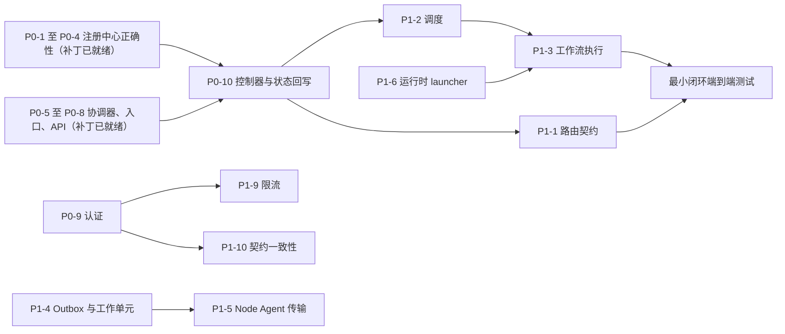

# ForgeMesh 改进优化方案

> **基线**：[Mekoforge/ForgeMesh](https://github.com/Mekoforge/ForgeMesh) `main` 分支，提交 `5a0be13`（`5a0be13fcd506d3e61454e14bfc1a4a6330304c2`，CHANGELOG 中为 v1.1.0 Unreleased）
> **配套补丁**：[`patches/forgemesh/0001–0008`](../patches/forgemesh/)，已在基线上应用并验证
> **编写日期**：2026-10-12

**阅读说明**

- 文中代码位置均指基线提交 `5a0be13`，格式为 `文件:行号`。
- 为了让表格短一些，`cp/` 代表 `packages/control-plane/src/forgemesh/controlplane/`，`gw/` 代表 `gateway/internal/`；其余路径都写全。
- 优先级的含义：
  - **P0**：会导致数据丢失、静默错误、系统无法运行，或者可以被直接利用的安全缺陷。
  - **P1**：打通最小可用闭环所必需的能力，以及高风险的安全加固。
  - **P2**：性能、可运维性和工程化。

---

## 目录

- [0. 摘要](#0-摘要)
- [1. 目标与原则](#1-目标与原则)
- [2. 问题总览](#2-问题总览)
- [3. 已验证的 P0 补丁](#3-已验证的-p0-补丁)
- [4. P0 详细说明](#4-p0-详细说明)
- [5. P1 方案](#5-p1-方案)
- [6. P2 优化](#6-p2-优化)
- [7. 路线图](#7-路线图)
- [8. 验收清单](#8-验收清单)
- [附录 A：补丁文件](#附录-a补丁文件)
- [附录 B：复现与冒烟方法](#附录-b复现与冒烟方法)
- [附录 C：术语](#附录-c术语)

---

## 0. 摘要

ForgeMesh 目前是一套“契约 + 组件原型”。资源模型、状态机、注册中心、协调器、Policy、决策路由、工作流执行器、插件 SDK 和 Go 网关都有代码和单元测试（基线 1115 个测试全部通过），但这些组件**没有被组装成一个能运行的系统**；已经实现的组件中，有几处会导致数据丢失或静默失败；README、CHANGELOG 和 OpenAPI 宣称的“v1.0.0 稳定版”能力，有相当一部分在代码里并不存在。

本文给出分阶段的改进方案，顺序是：先止血（数据正确性、能运行），再打通最小闭环，然后加固安全和供应链，最后做性能和工程化。

**已完成**：P0 中最紧迫的 8 项已经做成补丁（`patches/forgemesh/0001–0008`），可以直接用 `git am` 应用到基线上。

- 补丁新增 31 个回归测试，并把 1 个既有测试的断言从 200 改成契约要求的 201。这 32 个测试在基线代码上全部失败，补丁后全部通过。
- 全量测试从 1115 个增加到 1146 个，全部通过；`ruff check`、项目自带的 4 个 CI 校验脚本、`go vet`、`go test -race` 也都通过。

**还没完成的 P0**：真实认证（P0-9）和控制器驱动循环（P0-10）。这两项完成之前，ForgeMesh 不应该对外称为“稳定版”。

---

## 1. 目标与原则

### 1.1 最小可用闭环

第一个里程碑不是“功能齐全”，而是让下面这条链路真正跑通，并且每一步都有自动化测试覆盖：

1. **创建**：`POST /api/v1/inference-services` 持久化完整的 `spec`。
2. **协调**：控制器发现新资源，依次执行 Policy 校验、调度分配 GPU、部署工作流。
3. **状态回写**：`status.phase`、`conditions`、`observedGeneration` 和实例地址写回注册中心。
4. **路由**：网关按 `{svc}` 找到实例，转发流式推理请求。
5. **可观测**：同一个 `correlationId` 能串起网关日志、控制平面日志、审计记录和指标。
6. **删除**：`DELETE` 触发受控释放：停止实例、释放分配、清空 finalizer、物理删除。

目前这条链路在第 2 步就断了：生产代码里没有任何地方驱动协调器（见 P0-10），资源会永远停在 `Pending`。

### 1.2 原则

- **正确性优先于功能面**：先修数据一致性和失败路径，再加新特性。
- **每个修复都带回归测试**，而且测试必须在未修复的代码上失败。本文的所有补丁都按这个标准验证过。
- **文档跟着代码走**：没实现的能力不写进 CHANGELOG 的 Added，单独列在 Planned 里。
- **契约必须可测试**：OpenAPI 与实现之间要有自动化的漂移检测，不能靠人工对齐。
- **遵守 ADR-013**：迁移到 PostgreSQL 之前保持“单写者”约束，部署配置也要防止出现双写（见 6.4）。

### 1.3 应当保留的基础

改进不是推倒重来。以下设计是对的，后续重构时应该保留：

- 资源模型普遍使用 pydantic 的 `extra="forbid"`，状态机转移集中校验，契约清晰。
- “决策 ≠ 授权”的分层：决策只产出候选，授权由 Policy 和调度器完成；全部决策 Provider 失败时返回 503 而不是默认放行。
- Node Agent 只接受类型化任务，不提供远程 Shell（ADR-009）。
- 网关只用标准库，缓存键包含租户，实例健康检查有 half-open 恢复，客户端断开时会取消上游请求。
- `ProcessedKeyStore` 已经正确地用锁保护共享连接，可以作为其他 SQLite 存储的范本。
- 测试数量多、覆盖面广，为后续重构提供了安全网。

---

## 2. 问题总览

### 2.1 P0（10 项，其中 8 项已有补丁）

| 编号 | 问题 | 后果 | 位置 | 状态 |
|---|---|---|---|---|
| P0-1 | 注册中心多个线程共用一个 SQLite 连接，没有加锁。项目自己在测试注释里把它记为“缺陷 R-1（高）”，但没有修 | 并发写入互相回滚：接口报告成功，数据却没有落库；底层异常直接抛给调用方 | `cp/registry/store.py:146-151` | 补丁 0001 |
| P0-2 | 主键包含可为空的 `namespace`，而 SQLite 里 NULL 互不相等 | `namespace` 为空时可以无限创建同名资源 | `cp/registry/store.py:94,105` | 补丁 0002 |
| P0-3 | `request_delete`、`release_allocation` 先读后写，但写入时不带版本条件 | 覆盖并发更新；绕过并发新增的 finalizer；把已过期的分配改回“已释放” | `cp/registry/store.py:532-536,559-573,697-701` | 补丁 0003 |
| P0-4 | 标签过滤在 SQL `LIMIT` 之后才用 Python 执行；`limit` 不做校验 | 分页漏数据；`limit=-1` 变成返回全部 | `cp/registry/store.py:423-432` | 补丁 0004 |
| P0-5 | 协调器在“策略拒绝”“待人工审批”“分配失败”三条路径上都登记了去重键 | 重新入队后被幂等检查短路，永远不会重新评估。这与同一文件里的注释正好相反 | `cp/reconciler/core.py:166-168,184-189,217-219`（对照 `:132-133`） | 补丁 0005 |
| P0-6 | 可运行入口只注册了返回 501 的占位路由，真实 API 路由从未挂载；`main()` 吞掉 uvicorn 的异常；默认监听 `0.0.0.0` | 启动后的服务没有任何可用的业务接口；启动失败时静默退化成占位服务 | `cp/app.py:73-81,115-129,183-193` | 补丁 0006 |
| P0-7 | 控制平面包没有声明它实际导入的 `forgemesh-policy-engine`、`forgemesh-plugin-sdk`，也没有命令行入口 | 只按声明的依赖安装（例如构建镜像）时，导入协调器或插件管理器会报 `ModuleNotFoundError`；`make install` 用 `--no-deps` 把所有包都装上了，所以开发时察觉不到 | `packages/control-plane/pyproject.toml` | 补丁 0007 |
| P0-8 | 创建接口把请求体转成基类 `Resource`，`spec` 被丢弃；`kind` 由客户端任意指定；返回 200 而不是契约规定的 201 | 推理服务的期望状态根本没有保存；可以通过推理服务接口写入任意类型的资源 | `cp/api/routes.py:76-89,97-112` | 补丁 0008 |
| P0-9 | 没有认证：租户身份就是请求头里的任意字符串；网关只检查这个头存不存在；仓库里现成的 `AuthzWithToken` 没有接入，而且它的 token 不绑定租户 | 任何能访问网关或控制平面的人，都能读写任意租户的数据 | `cp/api/dependencies.py:114-124`；`gw/middleware/authz.go:26-50`；`gw/router/router.go:93` | 待做，设计见 [4.9](#49-p0-9-认证与租户绑定待做) |
| P0-10 | 生产代码里没有任何地方创建 `ReconciliationController`；`ReconcileResult.status_patch` 没人写回 | 创建的资源永远停在 `Pending`，系统什么都不会做 | `cp/reconciler/core.py`（没有调用方） | 待做，设计见 [4.10](#410-p0-10-控制器驱动循环与状态回写待做) |

### 2.2 P1（11 项）

| 编号 | 问题 | 位置 |
|---|---|---|
| P1-1 | **网关路由契约断裂**：解析器读取 `status.endpoints`，但资源模型禁止额外字段，又没有定义这个字段，OpenAPI 和 JSON Schema 里也没有；解析时不带 `namespace`；流式请求路径被原样拼到实例地址后面 | `gw/upstream/resolver.go:61-66,163`；`packages/resource-model/src/forgemesh/resource/inference.py:130-143`；`gw/stream/proxy.go:254-260` |
| P1-2 | **没有调度**：仓库里没有任何 `Scheduler` 实现；`ScheduleRequest` 不含资源身份和幂等键；协调器传给调度器的 `requirements` 永远是 `{}`；释放分配时用的键忽略 `namespace`，“一个资源一个活跃分配”的唯一索引不含 `tenant_id`；处于 `Scheduling`/`Unknown` 的资源会被直接物理删除，不检查它是否还持有分配 | `packages/core-contracts/src/forgemesh/core/scheduler.py:22-35,70`；`cp/reconciler/core.py:388,459`；`cp/registry/store.py:86,120-121,528-544` |
| P1-3 | **工作流不执行**：API 和协调器都用空步骤列表启动工作流；`ReferenceWorkflowRuntime.start` 只把状态改成 Running，从不调用它持有的执行器；工作流启动失败时协调器仍然报 `Ready=True` | `cp/api/routes.py:287`；`cp/reconciler/core.py:237-260`；`plugins/workflow-reference/provider.py:55,60-83` |
| P1-4 | **Outbox、审计、任务存储没有接入，且语义有缺陷**：`Outbox.put` 自己提交事务；发布失败的事件被标成 `failed` 后永远不会重试；Dispatcher 的“已处理”集合无限增长；`TaskStore`、`Outbox` 同样共用连接不加锁 | `cp/outbox.py:91-110,134-145,199`；`cp/tasks.py:153-158`；`cp/audit.py:74-77` |
| P1-5 | **Node Agent 没有网络传输**：客户端直接拿服务端的 Python 对象调用方法；`api/protobuf/agent.proto` 没有生成任何代码 | `packages/node-agent/src/forgemesh/nodeagent/server.py:146-170` |
| P1-6 | **运行时插件没有真实启动器**：vLLM、TGI 的默认 launcher 直接抛 `NotImplementedError`；Temporal 插件只有内存客户端 | `plugins/runtime-vllm/deploy.py:96-104`；`plugins/runtime-tgi/provider.py:174-191`；`plugins/workflow-temporal/provider.py` |
| P1-7 | **插件供应链与隔离**：HMAC 对称签名；不带制品内容时跳过摘要校验；注册时不验签；权限由插件清单自己授予；“隔离”只是枚举映射；10 个插件声明的 `entrypoint` 模块全部不存在，CI 的入口冒烟脚本也不检查 | `packages/plugin-sdk/src/forgemesh/plugin/signing.py:5-7,142-146`；`cp/plugin_manager.py:71-89,209-211`；`scripts/plugin_entrypoint_smoke.py:116-137` |
| P1-8 | **网关转发安全**：客户端的 `Authorization`、`Cookie` 原样转发给推理实例；实例地址没有白名单（SSRF）；无条件信任 `X-Forwarded-For` | `gw/stream/proxy.go:298-309`；`gw/upstream/resolver.go:199-205`；`gw/middleware/ratelimit.go:161-169` |
| P1-9 | **限流可以绕过**：按未经认证的租户头分桶，换一个租户头就是一个新桶 | `gw/middleware/ratelimit.go:150-158` |
| P1-10 | **API 契约不一致**：没有更新接口和 status 子资源；错误格式混用；缺少租户返回 400（契约是 401）；列表不返回 `nextPageToken`；决策 API 不传风险等级，导致高风险保护永远不会触发；等等 | 见 [5.10](#510-api-契约一致性p1-10) |
| P1-11 | **CLI 不可用**：每条命令都新建一个内存数据库，`apply` 之后 `get` 必然找不到；同样丢弃 `spec`；`delete` 绕过 finalizer 流程 | `packages/cli/src/forgemesh/cli/commands.py:23-38,98-107` |

### 2.3 P2（6 类）

| 编号 | 方向 | 要点 |
|---|---|---|
| P2-1 | SQLite 存储 | WAL 等 PRAGMA、专用写线程、TTL 改为周期清理、标签索引、`user_version` 迁移、在线备份 |
| P2-2 | 网关性能 | 解析器合并回源与负缓存、连接池调优、限流器分片、首字节前重试、请求体上限、真实的就绪探针 |
| P2-3 | 可观测性 | 内存中的指标和追踪接入 Prometheus 与 OTLP 导出，网关与控制平面关联 |
| P2-4 | 部署 | 补 Dockerfile；修正 compose 的变量名和端口；Kubernetes 加持久卷和 `Recreate` 策略 |
| P2-5 | CI 门禁 | 格式检查、`go vet`、`-race`、覆盖率阈值、类型检查、端到端冒烟、契约漂移测试、依赖漏洞扫描 |
| P2-6 | 文档与发布治理 | 版本稳定性表述、CHANGELOG 中不实的条目、README 错误、注释里的 Python 版本声明 |

---

## 3. 已验证的 P0 补丁

### 3.1 补丁清单

| 补丁 | 提交标题 | 修复 | 测试 |
|---|---|---|---|
| 0001 | fix(registry): serialize shared sqlite connection access (R-1) | P0-1 | `tests/contract/test_registry_hardening.py`（新建） |
| 0002 | fix(registry): enforce identity uniqueness when namespace is NULL | P0-2 | 同上 |
| 0003 | fix(registry): make request_delete and release_allocation compare-and-swap | P0-3 | 同上 |
| 0004 | fix(registry): apply label selectors before LIMIT and reject non-positive limits | P0-4 | 同上 |
| 0005 | fix(reconciler): do not record dedup keys on side-effect-free failure paths | P0-5 | `tests/unit/controlplane/test_reconciler.py` |
| 0006 | feat(control-plane): serve the real API from the runnable entrypoint | P0-6 | `tests/unit/controlplane/test_app.py`（新建） |
| 0007 | build(control-plane): declare missing dependencies and a console script | P0-7 | 无自动化测试，在干净虚拟环境里手工验证（见 [4.7](#47-p0-7-依赖声明缺失补丁-0007)） |
| 0008 | fix(api): persist InferenceService spec and validate create/list input | P0-8 | `tests/unit/controlplane/test_api.py`、`test_app.py` |

改动范围：10 个文件，+772/−142 行。只涉及控制平面包和测试，网关代码没有改动。

### 3.2 如何应用

```bash
git clone https://github.com/Mekoforge/ForgeMesh.git
cd ForgeMesh
git checkout -b improve/p0-fixes 5a0be13
git am /path/to/patches/forgemesh/*.patch

make install    # 创建 .venv，并以 editable 方式安装各子包
make test       # 预期：1146 passed
```

补丁是基于 `5a0be13` 生成的。如果上游 `main` 已经前进，先试 `git am -3`；冲突会集中在 `store.py`、`routes.py`、`app.py` 这三个文件。

### 3.3 验证结果

**测试**：全量测试从 1115 个增加到 1146 个，全部通过。补丁新增 31 个测试，另外修改了 1 个既有测试的断言（创建接口的返回码从 200 改为 201）。把业务代码换回基线后（方法见[附录 B](#附录-b复现与冒烟方法)），这 32 个测试全部失败：

| 测试文件 | 基线代码 | 补丁后 |
|---|---|---|
| `tests/contract/test_registry_hardening.py` | 9 个失败 | 9 个通过 |
| `tests/unit/controlplane/test_reconciler.py` | 6 个失败，15 个通过 | 21 个通过 |
| `tests/unit/controlplane/test_api.py` | 12 个失败，6 个通过 | 18 个通过 |
| `tests/unit/controlplane/test_app.py` | 收集阶段报错（导入了补丁新增的接口） | 5 个通过 |

其中 R-1 的并发测试依赖真实的线程调度。在基线代码上重复运行 10 次，10 次都失败；补丁后 10 次都通过。

其他检查：

- `ruff check .` 通过。
- `scripts/` 下的 4 个 CI 校验脚本（manifest 校验、OpenAPI 语义检查、元数据一致性、插件入口冒烟）全部通过。
- 网关 `go vet ./...` 和 `go test -race ./...` 通过。
- 在只装了声明依赖的干净虚拟环境里，控制平面全部 18 个模块都能导入，`forgemesh-control-plane` 可以直接启动（基线上 4 个模块导入失败，详见 [4.7](#47-p0-7-依赖声明缺失补丁-0007)）。

**复现脚本**：直接调用注册中心、协调器和 API，修复前后对比如下。

| 场景 | 基线 `5a0be13` | 补丁后 |
|---|---|---|
| `namespace` 为空，连续创建 3 次同名资源 | 3 次都成功，库里有 3 行 | 第 1 次成功，后 2 次 409，库里 1 行 |
| 同一个注册中心实例上并发：20 轮，每轮 32 个创建加 32 个必然失败的 CAS 更新 | 640 个创建中有 117 个“报告成功但没有落库”；同时泄漏出 `InterfaceError`、`SystemError`、`DatabaseError`、`OperationalError` | 没有丢失；640 个 CAS 全部是预期的 `ConflictError` |
| 策略拒绝后重新入队，此时策略已经放行 | 被幂等检查短路：策略只调用了 1 次，`status_patch` 为空 | 重新评估：策略调用 2 次，结果为 `Ready=True` |
| `request_delete` 读和写之间发生了并发更新 | 并发写入的标签被覆盖（丢失更新） | 抛出 `ConflictError`，并发更新保留，调用方重试即可 |
| `POST` 一个 `spec` 不合法的推理服务 | 200，`spec` 被静默丢弃 | 400，并返回逐字段的校验错误 |
| 向推理服务接口 `POST` 一个任意 `kind` | 200，写入了任意类型的资源 | 400 |
| `GET ...?limit=-1` | 200，返回全部 | 400 |
| 用任意 `X-Tenant-Id` 读取数据 | 200 | 200（P0-9 还没修，预期仍可绕过） |

**端到端冒烟**：Go 网关（端口 18481）在前，控制平面（端口 18480，`FORGEMESH_DB_PATH` 指向一个文件库）在后：

- 创建返回 201，`spec` 已持久化，服务端分配了 `uid`，`status.phase` 为 `Pending`；
- 重复创建返回 409；缺少 `spec` 返回 400；`limit=-1` 返回 400；
- 控制平面 `/readyz` 返回 200；
- 没有注入决策路由时，`/api/v1/decisions` 返回 503 `DECISION_ROUTER_UNAVAILABLE`。

### 3.4 行为变化（升级须知）

合入补丁后，下面这些行为和基线不同，调用方与部署需要相应调整：

1. **创建推理服务必须带合法的 `spec`**，成功返回 **201**（基线返回 200，并丢弃 `spec`）。`kind` 必须是 `InferenceService`；请求体中的 `tenantId`、`uid`、`resourceVersion` 由服务端覆盖；`status` 被忽略。
2. **默认监听地址改为 `127.0.0.1:8080`**（基线是 `0.0.0.0:8080`）。在容器里部署时需要设置 `FORGEMESH_HOST=0.0.0.0`；端口用 `FORGEMESH_PORT` 配置。
3. **数据默认落盘**：数据库路径取自 `FORGEMESH_DB_PATH`，默认是当前目录下的 `forgemesh.db`（基线入口不连接任何数据库）。数据库在应用启动（lifespan）时才打开，导入模块不再产生文件。
4. **如果存量数据库里已经有重复资源，会拒绝启动**：补丁 0002 在启动时创建唯一索引；发现 `(tenant_id, kind, namespace, name)` 重复（`namespace` 为空也算）时，会抛出 `PreconditionFailedError` 并给出第一组重复项。需要先人工清理重复的行。
5. **`DELETE` 可能返回 409**：读写之间发生并发修改时，`request_delete` 抛出 `ConflictError`，API 映射为 409 错误信封，客户端应当重试。`release_allocation` 同理。
6. **`limit` 必须在 1 到 1000 之间**，否则 API 返回 400；在注册中心层面，`limit < 1` 会抛出 `ValueError`。
7. **`/readyz` 会真实探测数据库**，失败时返回 503 `NOT_READY`（基线永远返回 ok）。
8. **`PLACEHOLDER_ROUTES` 已删除**（从 `app.py` 和包的 `__all__` 中移除）。没有安装 FastAPI 时使用的标准库兜底服务仍然保留，只提供探针和 501。

---

## 4. P0 详细说明

每一项按“问题、根因、修复、验证、后续”组织。

### 4.1 P0-1 共享 SQLite 连接没有加锁（补丁 0001）

**问题**：`SQLiteRegistry` 在 `__init__` 中创建了一个 `check_same_thread=False` 的连接，所有方法都通过 `asyncio.to_thread` 在默认线程池里使用这个连接，没有任何锁。

**根因**：Python `sqlite3` 的事务是连接级的。线程 A 的 CAS 失败后执行 `rollback()`，会把线程 B 已经执行、还没提交的 INSERT 一起回滚；B 随后调用 `commit()` 时已经没有活动事务，`commit()` 什么也不做，B 却向调用方报告成功。多个线程交错使用同一个连接，还会抛出 `InterfaceError` 这类底层错误。

项目在 `tests/contract/test_registry_consistency.py:20-40` 中把这个问题记为“缺陷 R-1（高）”，测得约 15% 的并发轮次会出问题，但标注了“不在本任务修复”。同一个仓库里的 `ProcessedKeyStore`（`cp/reconciler/dedup.py:108-111,133`）已经用锁解决了完全相同的问题。

**修复**：增加一把 `threading.RLock`，所有数据库操作（包括只读查询和 `close`）都通过 `_run()` 在持锁状态下执行：

```python
async def _run(self, fn: Callable[[], _T]) -> _T:
    def _locked() -> _T:
        with self._lock:
            return fn()
    return await asyncio.to_thread(_locked)
```

读操作也必须加锁：在 rollback-journal 模式下，没有取完结果的 SELECT 会持有共享锁，而且它同样在共享连接上与其他线程交错。

**验证**：`test_shared_instance_concurrent_writes_are_not_lost` 在同一个实例上跑 10 轮，每轮并发发起 32 个创建和 32 个必然失败的 CAS 更新，断言创建全部成功并落库、CAS 全部是 `ConflictError`。

**后续**：

- `TaskStore`（`cp/tasks.py:153-158`）和 `Outbox`（`cp/outbox.py:75-79`）用的是同样的模式，接入生产路径之前必须一并处理（见 5.4）。
- 加锁之后所有数据库操作是串行的。这符合 ADR-013 的单写者模型，但吞吐上限就是一个连接。更好的结构是“一个专用写线程，加上 WAL 模式下的只读连接”（见 6.1）。

### 4.2 P0-2 `namespace` 为空时不去重（补丁 0002）

**问题**：`PRIMARY KEY (tenant_id, kind, namespace, name)` 中 `namespace` 可以为空，而 SQLite 把每个 NULL 当作不同的值，所以 `namespace` 为空时同名资源可以无限插入。

PostgreSQL 版的设计（`docs/architecture/development-plan.md:1816`）用的是 `UNIQUE NULLS NOT DISTINCT`，并被标为“已闭环”，但 SQLite 实现里没有等价的约束。

**修复**：在 `_init_schema` 的迁移步骤之后，创建一个表达式唯一索引：

```sql
CREATE UNIQUE INDEX ux_resources_identity
    ON resources(tenant_id, kind, COALESCE(namespace, ''), name);
```

建索引之前先查重。如果存量数据已经有重复，就抛出 `PreconditionFailedError` 并给出第一组重复的键，而不是让建索引失败、只留下一条难以理解的 `IntegrityError`。

**验证**：`namespace=None` 时重复创建得到 `ConflictError`；构造一个含重复行的旧库，打开时报错，且错误信息里包含重复项。

**后续**：迁移到 PostgreSQL 时使用文档里的 `UNIQUE NULLS NOT DISTINCT`（需要 PG15 以上）。在此之前，建议规定“`namespace` 为空等同于 `default`”，并在写入时统一规范化，从源头上消除这个歧义。

### 4.3 P0-3 删除和释放没有 CAS（补丁 0003）

**问题**：`request_delete` 先读出 `phase`、`finalizers`、`resource_version`，算好之后执行 UPDATE 或 DELETE，但 WHERE 条件里只有资源身份，没有版本号。代码里其实已经写了“`rowcount == 0` 时抛出 `ConflictError("request_delete raced with concurrent write")`”的分支（`store.py:574-579`），可是 WHERE 里没有版本条件，这个分支只有在行被删掉时才会触发，起不到并发保护的作用。`release_allocation` 也一样：它校验了状态机，但 UPDATE 不带状态条件。

**后果**：

- 读取之后发生的并发更新（例如控制器写入的标签）会被 Terminating 的写入覆盖；
- 读取时没有 finalizer、读取后有人加了 finalizer，资源仍然会被物理删除，finalizer 保护失效；
- 分配在读取之后被租约回收任务改成 `Expired`，又被改回 `Released`。

**修复**：所有写入都加上“读取时的版本”（分配则是“读取时的状态”）作为条件，`rowcount == 0` 时回滚并抛出 `ConflictError`：

```sql
UPDATE resources SET ...
 WHERE tenant_id=? AND kind=? AND namespace IS ? AND name=? AND resource_version=?;

DELETE FROM resources
 WHERE tenant_id=? AND kind=? AND namespace IS ? AND name=? AND resource_version=?;

UPDATE allocations SET status='Released', released_at=datetime('now')
 WHERE tenant_id=? AND id=? AND status=?;
```

API 层把这个 `ConflictError` 映射为 409 错误信封。

**验证**：测试用一个包装过的连接，在 `request_delete` 读取之后、写入之前，在同一个连接上提交一次“别人的”写入，从而确定性地复现竞态。3 个测试分别覆盖：

- 并发更新不会被覆盖：第一次删除得到冲突；重试后进入 Terminating，并发写入的标签仍在；
- 并发添加的 finalizer 不会被绕过：资源没有被物理删除，finalizer 保留；
- 已过期的分配不会被改回已释放。

### 4.4 P0-4 标签过滤在 LIMIT 之后（补丁 0004）

**问题**：`list()` 先用 `LIMIT ?` 取出一页，再在 Python 里按标签过滤。如果第一页的 100 条都不匹配，调用方拿到空页，会以为没有数据；分页游标也会跳过本该返回的记录。另外，`limit` 没有校验，而 SQLite 里 `LIMIT -1` 表示不限量。

**修复**：标签条件下推到 SQL，在 `ORDER BY ... LIMIT` 之前执行：

```python
for key, value in sorted(labels.items()):
    sql += " AND json_extract(body, ?) = ?"
    params.extend([f'$.metadata.labels."{key}"', value])
```

标签键用双引号包起来，这样 `app.kubernetes.io/name` 这类包含 `.` 和 `/` 的键也能正确匹配；包含 `"` 或 `\` 的键直接拒绝。`limit < 1` 时抛出 `ValueError`。

**验证**：150 个资源里只有最后 10 个带目标标签，每页 4 条往后翻，必须恰好取回这 10 个；`limit` 为 0 或 -1 时报错。

**后续**：`json_extract` 用不上索引，标签查询仍然是在同一租户、同一类型下扫描。数据量大了以后应该改成独立的标签表（见 6.1）。

### 4.5 P0-5 失败路径登记了去重键（补丁 0005）

**问题**：协调器入口先查去重键，已经处理过就直接返回 `done=True`。但是“策略拒绝”（`core.py:166-168`）、“待人工审批”（`:184-189`）、“调度分配失败”（`:217-219`）这三条路径，在返回 `requeue_after` 之前都登记了去重键。结果是 30 秒（或 10 秒）后重新入队的协调会被幂等检查短路，什么也不做：审批通过了也不会部署，分配失败了也不会重试。

这与同一个文件 `:132-133` 的注释“失败路径不登记 dedup_key，保证 requeue 重试”正好相反。

**修复**：删掉这三处登记。这三条路径都没有产生副作用，重复执行是安全的。

**验证**：

- `test_reconcile_requeue_after_policy_block_is_reevaluated` 参数化覆盖“拒绝、待审批”两种决策和“内存去重集合、SQLite 持久化去重库”两种存储，断言第二轮协调重新调用了策略；
- `test_reconcile_requeue_after_allocation_failure_retries_allocation` 断言分配失败后的重试会再次调用调度器。

**后续**：工作流启动失败时（`:237-260`），协调器仍然登记去重键并报告 `Ready=True`，这同样是错的。但修复它的前提是调度分配本身是幂等的，否则重试会重复分配 GPU。所以这一项放到 P1-3，和 P1-2 一起解决。

### 4.6 P0-6 可运行入口没有挂载真实路由（补丁 0006）

**问题**：`cp/api/routes.py` 里已经实现的真实路由只在测试中被挂载过。`cp/app.py` 的 `create_app()` 注册的是 `PLACEHOLDER_ROUTES`，所有业务接口都返回 501；`/readyz` 永远返回 ok；`main()` 用 `except Exception: pass` 吞掉 uvicorn 的所有启动错误（比如端口被占用），然后静默启动一个只会返回 501 的标准库兜底服务。

CHANGELOG `[1.0.0]` 中“所有端点从 501 Not Implemented 占位升级为正式实现”的说法因此并不成立。

**修复**：

- `create_app(db_path=None)` 挂载 `create_api_router()`。数据库在 lifespan 中打开、退出时关闭，导入模块不再有文件系统副作用。这一点很重要，因为 `app = create_app()` 在模块导入时就会执行。
- `/readyz` 调用注册中心新增的 `ping()`（执行 `SELECT 1`），失败时返回 503 `NOT_READY` 错误信封。
- 配置来自环境变量：`FORGEMESH_DB_PATH`（默认 `forgemesh.db`）、`FORGEMESH_HOST`（默认 `127.0.0.1`）、`FORGEMESH_PORT`（默认 `8080`）。
- `main()` 不再吞异常；只有在没装 FastAPI 时才使用标准库兜底服务。
- `routes.py` 依赖 `app.py` 里的 `error_envelope`，而 `app.py` 又要挂载路由。为了避免循环导入，路由在 `create_app()` 内部延迟导入。

**验证**：5 个测试分别覆盖：

- 真实路由可用，且重启后数据仍在；
- 数据库路径取自环境变量；
- `create_app()` 不会创建任何文件；
- 关闭数据库之后 `/readyz` 返回 503；
- 没有注入决策路由时 `/decisions` 返回 503，而不是 501。

**后续**：`cp/api/dependencies.py:52-56` 的 `get_registry()` 在未初始化时会静默创建一个内存库。建议改为抛出 `ComponentNotReadyError`，避免配置错误时数据悄悄写进内存。

### 4.7 P0-7 依赖声明缺失（补丁 0007）

**问题**：控制平面的代码导入了 `forgemesh.policy`（`cp/reconciler/core.py:42`）和 `forgemesh.plugin`（`cp/plugin_manager.py:28`），但 `pyproject.toml` 没有声明这两个包，也没有声明命令行入口。`make install` 对每个子包都使用 `pip install --no-deps -e`，开发环境里所有包本来就都装好了，所以察觉不到。如果只按声明的依赖安装（例如构建镜像），`forgemesh.controlplane` 包本身以及 API、注册中心模块都能正常导入，但导入协调器（`forgemesh.controlplane.reconciler`）或插件管理器（`forgemesh.controlplane.plugin_manager`）时会报 `ModuleNotFoundError`。

**修复**：依赖中加入 `forgemesh-policy-engine` 和 `forgemesh-plugin-sdk`，并增加命令行入口 `forgemesh-control-plane = "forgemesh.controlplane.app:main"`。

**验证**：新建一个干净的虚拟环境，只装 pydantic、fastapi、uvicorn，以及控制平面声明的依赖闭包（用 `--no-deps` 逐个安装），然后逐个导入 `forgemesh.controlplane` 下的全部 18 个模块：

| | 基线 | 应用补丁后 |
|---|---|---|
| 依赖闭包 | 控制平面、core、resource-model、workflow-api、decision-api | 另加 policy-engine、plugin-sdk |
| 模块导入 | 14 个成功；协调器包的 3 个模块和插件管理器失败（`No module named 'forgemesh.policy'` / `'forgemesh.plugin'`） | 18 个全部成功 |
| 启动命令 | 没有 `forgemesh-control-plane` | 可以直接启动；`/healthz`、`/readyz` 返回 200，附录 B 的创建请求返回 201 |

**后续**：这些内部包没有发布到 PyPI，单独安装时要先装好它们，或者改用 uv workspace 统一管理（见 6.6）。建议在 CI 中加一个检查：在全新的虚拟环境里只安装控制平面及其声明的依赖，然后用 `pkgutil.walk_packages` 逐个导入全部子模块。只导入 `forgemesh.controlplane` 包本身不够，基线上这一步是成功的。其他 Python 包也照此检查。

### 4.8 P0-8 创建接口丢弃 `spec`（补丁 0008）

**问题**：`_build_resource` 把请求体转换成基类 `Resource`（`extra="forbid"`，没有 `spec`），然后写入注册中心。也就是说，推理服务的模型、运行时、GPU 需求从来没有被保存过，后续的协调和调度也就无从谈起。`kind` 直接取自请求体，可以通过推理服务接口写入任意类型的资源。接口返回 200，而 OpenAPI 定义的是 201。

**修复**：

- 用强类型的 `InferenceService.model_validate` 构造资源；校验失败时返回 400 错误信封，附带逐字段的错误；
- `kind` 必须是 `InferenceService`，`metadata` 必须是对象；
- 剥离客户端提供的服务端字段（`tenant_id`、`tenantId`、`uid`、`resourceVersion`），由服务端设置租户和 `uid`；忽略客户端提供的 `status`；
- 成功返回 201；重名返回 409 错误信封；
- 两个列表接口校验 `limit` 在 1 到 1000 之间；`DELETE` 遇到并发冲突时返回 409。

**验证**：新增的测试覆盖：

- `spec` 原样保存，服务端字段由服务端分配；
- 4 类非法请求体（缺少 `spec`、`kind` 错误、`metadata` 不是对象、`spec` 含未知字段）返回 400，并且不落库；
- 两个列表路径上，`limit` 为 -1、0、1001 时都返回 400。

**后续**：GET 和 DELETE 的 404 仍然是 FastAPI 默认的 `{"detail": ...}` 格式，与错误信封不一致。统一处理见 5.10。

### 4.9 P0-9 认证与租户绑定（待做）

**现状**：

- 控制平面的 `get_tenant_id` 直接信任 `X-Tenant-Id` 请求头，缺失时返回 400（OpenAPI 定义的是 401）。
- 网关的 `Authz` 中间件只检查租户头是否非空（`gw/middleware/authz.go:26-50`，`:38` 处写着“TODO(生产): 校验 JWT/OIDC”）。
- 仓库里有 `AuthzWithToken`（静态 token 白名单），但组装路由时用的是 `Authz`（`gw/router/router.go:93`），配置项里也没有 token 相关的设置，所以它根本无法启用。即使启用，token 也不绑定租户：拿着任何一个有效 token 的人，仍然可以声称自己是任意租户。
- 网关自己的注释（`authz.go:14-21`）明确要求下游必须二次校验租户身份，而控制平面没有做。

**目标**：租户身份来自经过验证的凭证，而不是客户端可以随便填写的请求头；控制平面不依赖“请求一定经过网关”这个假设。

**方案**：

1. **网关**：校验 OIDC/JWT 的 `iss`、`aud`、`exp`、`nbf`，JWKS 带缓存并支持密钥轮换，允许少量时钟偏差。从约定的 claim（例如 `tenant_id`）取出租户，然后**覆写**入站的 `X-Tenant-Id`，丢弃客户端提供的值。凭证缺失或无效时返回 401；JWKS 不可用时拒绝请求（fail closed）。
2. **控制平面**：把 `get_tenant_id` 换成 `get_principal`，返回 `Principal(subject, tenant_id, scopes)`。控制平面自己验证凭证（同一个 JWT，或者网关签发的短期内部 token，再加上网关到控制平面的 mTLS），不信任裸请求头。凭证缺失或无效返回 401，越权返回 403，与 OpenAPI 对齐，并补上 `components.securitySchemes`。
3. **过渡方案**：接入 OIDC 之前，可以先用“API key → 租户”的映射表（只保存 key 的哈希）替代现在不绑定租户的 token 白名单。
4. **本地开发**：只有显式设置 `FORGEMESH_AUTH_MODE=dev` 才允许信任请求头；这个模式下只允许监听回环地址，并在启动时打印醒目的警告。
5. **限流**改为按已认证的主体分桶，也就是 P1-9，随本项一起完成。

**验收**：

- token 里的租户是 A，请求头写的是 B：网关把请求头覆写成 A，访问 B 的资源返回 404 或 403；
- 绕过网关、不带凭证直接访问控制平面：返回 401；
- 现有 1146 个测试通过统一的测试夹具注入凭证之后，仍然全部通过。

**影响面**：网关的中间件和配置、控制平面的依赖注入、所有路由的依赖声明、OpenAPI。主要风险是测试改动量大，需要先做一个统一的认证夹具。

### 4.10 P0-10 控制器驱动循环与状态回写（待做）

**现状**：`ReconciliationController` 实现了 9 步协调和受控删除子流程，也有单元测试。但生产代码中没有任何地方创建它、监听资源变化、调用 `reconcile()`，或者把返回的 `status_patch` 写回注册中心。注册中心也没有“只更新 `status`”的接口。

**方案**：新增 `cp/controller/manager.py`，在应用的 lifespan 中启动。

- **变更来源**：短期内，注册中心每次写入时在同一个事务里追加一条变更记录（自增 id），控制器按 id 增量读取。这张表就是 P1-4 中 Outbox 的雏形。启动时先全量列出一次，重建工作队列。
- **工作队列**：以 `(tenant, kind, namespace, name)` 为键去重的延迟队列，支持 `requeue_after`；失败时指数退避，设置上限并加入随机抖动。
- **并发模型**：N 个 worker 协程；同一个键在同一时刻只由一个 worker 处理。
- **状态回写**：注册中心新增 `update_status(kind, namespace, name, tenant_id, patch, expected_version)`，作为 status 子资源：只修改 `status` 和 `observedGeneration`，不增加 `generation`，以 `resource_version` 做 CAS；冲突时重新入队。
- **去重键的时机**：去重键包含 `generation`。把登记去重键的时机从 `reconcile()` 内部移到“状态回写成功之后”，避免出现“已经登记、状态却没有写进去”的情况。
- **ADR-013**：控制器和 API 在同一个进程里运行，满足单写者约束。以后要多副本，必须先实现 leader 选举（PostgreSQL advisory lock 或 Kubernetes Lease）。

**验收**：

- 创建资源后，在有限时间内，`status` 从初始的 `Pending` 推进到协调结果。在没有调度器的环境中，结果应该是带原因的 `Ready=False`，而不是永远 `Pending`；
- 进程被 `kill -9` 后重启，工作队列能从注册中心重建，不会丢失待处理的资源；
- 同一个 `generation` 的资源重复入队，不会重复产生副作用。

**影响面**：新增的控制器模块、注册中心新增的两个方法、应用的 lifespan。它是 P1-1、P1-2、P1-3 的前置条件。

---

## 5. P1 方案

### 5.1 网关路由契约（P1-1）

**现状**：

- 网关解析器从 `GET /api/v1/inference-services/{svc}` 的响应里读取 `status.phase` 和 `status.endpoints`（`resolver.go:61-66`）。但 `InferenceServiceStatus` 只有 `phase`、`observedGeneration`、`conditions` 三个字段，并且是 `extra="forbid"`（`inference.py:130-143`），`endpoints` 根本存不进去；`api/` 下的 OpenAPI 和 JSON Schema 中也没有这个字段。因此网关的流式路由永远解析不出实例。
- 解析请求不带 `namespace`（`resolver.go:163`），而控制平面按 `namespace` 精确匹配，所以放在命名空间里的服务永远找不到。
- 流式路由是 `/api/v1/inference/{svc}/chat`（`router.go:44`），`buildUpstreamURL` 把这个路径原样拼到实例地址后面（`proxy.go:254-260`）。而 vLLM 提供的是 `/v1/chat/completions`，TGI 是 `/generate_stream`，实例会返回 404。

**方案**：

1. `InferenceServiceStatus` 增加 `endpoints: list[Endpoint]`，每一项包含 `url`、`ready`、`instanceId`、`protocol`（例如 `openai-chat`、`tgi-generate`），同步更新 JSON Schema 和 OpenAPI。只有控制器可以写入（通过 4.10 的 status 子资源）。
2. 路由带上命名空间：`/api/v1/namespaces/{ns}/inference/{svc}/chat`；保留不带命名空间的路由，作为 `default` 命名空间的别名。解析器的缓存键加入命名空间。
3. 由 `protocol` 决定路径映射：网关把 `/chat` 映射成对应运行时的真实路径，不再原样拼接。
4. 网关转发之前，用 5.8 中的白名单校验 `url`。

**验收**：用一个 HTTP SSE 桩服务冒充运行时，经控制器写入 `endpoints` 后，通过网关的 `/chat` 拿到流式响应；命名空间内的服务和默认命名空间里的同名服务互不串扰。

### 5.2 调度（P1-2）

**现状**：

- 仓库里只有抽象类 `Scheduler`（`scheduler.py:70`），没有任何实现；生产代码也没有任何地方调用 `put_allocation`。
- `ScheduleRequest` 只有 `tenant_id`、`resource_kind`、`requirements` 三个字段（`scheduler.py:22-35`），调度器不知道自己在为哪个资源分配，也就无法做到幂等。
- 协调器的 `_compute_diff` 里 `requirements` 永远是 `{}`（`core.py:459`），`spec.resources` 里的 GPU 需求到不了调度器。
- 删除时查找分配用的键是 `f"{kind}/{name}"`（`core.py:388`），不同命名空间里的同名资源会释放掉对方的分配。
- 受控删除只把 `Ready`、`Degraded`、`Updating`、`Deploying`、`Verifying` 视为“有副作用”（`store.py:86`）。处于 `Scheduling` 和 `Unknown` 的资源会被直接物理删除，即使它已经持有分配，这些分配就此泄漏。
- “每个资源只能有一个活跃分配”的唯一索引是 `allocations(resource_id) WHERE status = 'Active'`（`store.py:120-121`），不含 `tenant_id`。如果分配按协调器释放时使用的 `kind/name` 作为 `resource_id` 写入，会有两个后果：上面泄漏的分配会让同名资源重建后无法再分配；不同租户里的同名资源也会互相冲突，后到的租户分配失败。

**方案**：

1. `ScheduleRequest` 增加 `resource_ref`（租户、类型、命名空间、名称、`uid`）和 `idempotency_key`（取 `uid` 加 `generation`）。`allocations.idempotency_key` 已经有唯一约束，可以直接复用。
2. 分配记录用资源的 `uid` 关联，不再使用 `kind/name`；唯一索引改为 `(tenant_id, resource_id)`，与查询时的租户过滤保持一致。
3. `_compute_diff` 从 `spec.resources.accelerator` 提取需求（类型、数量、最小显存）。
4. 实现一个最小可用的调度器：基于 Node Agent 心跳上报的设备信息（`gpu-nvidia` 插件已经能通过 pynvml 采集）做 first-fit，之后再做装箱优化。
5. 受控删除时，只要存在活跃分配就追加释放用的 finalizer，与 `phase` 无关。
6. 利用已有的 `lease_until` 字段和 `Expired` 状态，实现租约到期回收任务。

**验收**：同一个 `generation` 重放协调，不会产生第二个分配；删除处于 `Scheduling` 的资源后，没有残留的活跃分配，同名资源重建后可以重新分配；不同命名空间、不同租户里的同名资源各自持有独立的分配。

### 5.3 工作流执行（P1-3）

**现状**：

- API（`routes.py:287`）和协调器（`core.py:241-244`）都用 `steps=[]` 构造工作流定义；
- `ReferenceWorkflowRuntime` 在构造时保存了一个 `WorkflowExecutor`（`provider.py:55`），但 `start()` 只创建运行记录并把状态推进到 Running（`:60-83`），从来不调用执行器，所以运行永远停在 Running；
- 工作流启动失败时，协调器只记一条警告，然后登记去重键并报告 `Ready=True`（`core.py:246-260`）。

**方案**：

1. `start()` 创建运行记录后，把执行器的 `execute_workflow` 作为后台任务运行，按结果推进到 Succeeded 或 Failed，失败时运行补偿逻辑（`CompensationExecutor` 已经存在）。进程重启后，从存储中恢复没有完成的运行。
2. 定义真实的部署工作流：准备模型、部署实例、注册路由、验证服务。复用 `runtime-vllm` 插件已有的 `ModelPreparer`、`VLLMDeployer`、`ServiceVerifier`。
3. 协调器启动工作流后，把 `phase` 置为 `Deploying` 并重新入队，由工作流完成事件推进到 `Ready`（同时写入 `status.endpoints`）；启动失败时报 `Ready=False` 并退避重试，不登记去重键。
4. 依赖 P1-2 的分配幂等，否则重试会重复分配 GPU。

**验收**：某个步骤失败时，`phase=Failed`、`Ready=False`，补偿逻辑释放了分配；进程在工作流执行到一半时重启，能继续执行或完成补偿，不会永远卡在 Running。

### 5.4 Outbox、审计与工作单元（P1-4）

**现状**：`Outbox`、`Dispatcher`、`AuditLog`、`TaskStore`、`ProcessedKeyStore` 都有实现和测试，但生产代码里只有 `SQLiteRegistry` 被实例化（`dependencies.py:48` 和 CLI）。此外：

- `Outbox.put` 内部自己 `commit()`（`outbox.py:110`），没法放进调用方控制的事务。如果先写事件、后写业务数据，业务写入失败时事件已经提交了；
- `mark_failed` 把事件改成 `failed`（`:134-145`），而 `get_pending` 只取 `pending`。也就是说，一次发布失败，这个事件就永远不会再被投递；
- `Dispatcher._processed`（`:199`）和 `IdempotentConsumer` 用内存集合去重，会无限增长，而且重启就失效；
- `TaskStore`、`Outbox` 与 P0-1 一样，共用连接却不加锁。

**方案**：

1. 引入 `UnitOfWork`：在同一个连接、同一个事务里完成资源写入、Outbox 事件和审计记录；`Outbox.put` 不再自己提交。
2. 失败的事件改为记录 `retry_count` 和 `next_attempt_at`，按指数退避重试；超过上限进入 `dead` 状态并产生告警指标，同时提供人工重新投递的入口。
3. 去掉 Dispatcher 的内存集合，以数据库状态为准；消费端的幂等改用持久化的处理键表（可以复用 `ProcessedKeyStore`）。
4. 所有 SQLite 存储复用同一个数据库封装（锁、PRAGMA、迁移），不再各自管理连接。

**验收**：注入发布失败之后，事件最终仍被投递；进程重启后不会重复投递已经发布的事件；资源写入失败时没有孤立的事件。

### 5.5 Node Agent 传输（P1-5）

**现状**：`AgentClient.connect(server: AgentServer)` 直接接收服务端的 Python 对象（`server.py:146-170`），所有“通信”都是进程内的方法调用；`api/protobuf/agent.proto` 没有生成任何代码，各个包也没有 gRPC 依赖。CHANGELOG `[1.0.0]` 中的“gRPC 通信层：控制平面 ↔ Node Agent 双向流”并不存在。

**方案**：

1. 根据 `agent.proto` 生成 Python 桩代码（grpcio-tools 或 buf），在生成的代码和现有的 `AgentServer`/`AgentClient` 之间加一层适配，保留现有的业务逻辑和测试。
2. 控制平面与节点之间使用 mTLS，每个节点一张证书；任务携带签名和幂等键（`TaskStore` 已经有 `idempotency_key`）。
3. 心跳超时后，节点标为 `NotReady`，节点上的实例 `phase` 变为 `Unknown`，由调度器回收或迁移。

**验收**：控制平面和 Agent 作为两个独立进程，通过真实网络联调成功；断网恢复后，同一个任务不会被重复执行。

### 5.6 运行时插件与 GPU（P1-6）

**现状**：

- vLLM 和 TGI 的 `_default_launcher` 直接抛出 `NotImplementedError`（`runtime-vllm/deploy.py:96-104`、`runtime-tgi/provider.py:174-191`），只能在测试里注入 mock；实例记录保存在内存字典里。
- Temporal 插件只有抽象客户端和 `InMemoryTemporalClient`，没有 temporalio 依赖，与 CHANGELOG 中“生产级工作流编排引擎集成”的说法不符。
- `gpu-nvidia` 已经能通过 pynvml 枚举设备，这部分是实打实的。

**方案**：

1. 至少提供一种真实的 launcher：容器方式（Docker/Podman API 或 Kubernetes Pod），或者本地进程方式。启动参数由 `spec` 生成，并通过 `/health` 做就绪检测。
2. 提供一个“假运行时” launcher（启动一个 HTTP SSE 桩服务），让 CI 在没有 GPU 的环境下也能跑和真实环境相同的端到端测试。
3. 把 `gpu-nvidia` 的设备发现接入 Node Agent 的心跳上报，作为调度器的输入。
4. Temporal：要么基于 temporalio 实现真实的客户端，要么从 CHANGELOG 中撤回这一条，改列在 Planned 里。

**验收**：在有 GPU 的节点上，用 vLLM 跑通 1.1 节的完整闭环；CI 中用假运行时跑通同一套测试。

### 5.7 插件供应链与隔离（P1-7）

**现状**：

- **签名**：使用 HMAC-SHA256，“私钥”和“公钥”是同一把密钥（`signing.py:5-7`），能验签的人就能伪造签名。`verify` 只有在制品携带 `content` 时才会重新计算摘要（`:142-146`）；不带内容时只校验“摘要字符串的签名”，制品本身根本没有被校验。它也不检查 `algorithm` 字段。
- **注册**：`PluginManager.register` 不验签，也不调用隔离检查（`plugin_manager.py:71-89`）。模块注释里说的“安装时校验”并没有实现。
- **权限**：`check_permissions` 里的“已授予权限”直接取自插件清单自己声明的 `permissions`（`:209-211`），插件想要什么权限就有什么权限。
- **隔离**：`isolation.py` 只有“信任等级 → 隔离模式”的映射，和一个需要插件自觉调用的 `check_access`，没有任何进程、容器或系统调用层面的隔离。权限的命名也对不上：清单里写的是 `network.egress`、`resource.write` 这类点分名称，而隔离检查比较的是 `network`、`database`、`admin`。
- **入口**：10 个插件的清单都声明了 `entrypoint: python -m forgemesh_<name>`，但这些模块全部不存在（没有任何插件目录包含 `pyproject.toml` 或 `__main__.py`）。CI 的入口冒烟脚本只检查 `entrypoint` 字段非空，然后按文件路径加载 `provider.py`（`plugin_entrypoint_smoke.py:116-137`），从来没有按声明的入口启动过插件。
- **自相矛盾的清单**：`decision-typesafe-jev` 声明了 `isolation: restricted-rpc`，而受限 RPC 模式禁止直接访问网络（`isolation.py:10-11,66`）；可它的实现直接用 `urllib` 调用 TypeSafe 的云端 API。

**方案**：

1. **签名**：改用 Ed25519 非对称签名，或者直接采用 Sigstore/cosign。签名对象是“制品内容摘要加清单摘要”；`verify` 必须重新计算制品摘要（从制品存储读取内容），并校验 `algorithm`。
2. **注册**：`register` 时强制验签并执行清单校验；未签名的插件只能在显式开启的开发模式下加载。
3. **权限**：引入由管理员策略授予的 `PluginGrant` 记录，`check_permissions` 依据授予记录判断；清单里的权限只代表“申请”。
4. **命名**：定义统一的权限枚举，并用 JSON Schema 校验清单。
5. **隔离**：`restricted-rpc` 需要真实的进程边界（子进程加 RPC，配合 rlimit、seccomp、无网络命名空间，或者直接用容器）。实现之前，清单不应该声明 `restricted-rpc`。
6. **入口**：为每个插件提供可执行的入口（`__main__.py`，或者改成 `module:Class` 形式），CI 冒烟改为按清单入口真正启动插件，并做一次健康检查。
7. **typesafe-jev**：要么通过宿主提供的出网 RPC 访问外部 API，要么如实声明为进程内插件加 `network.egress`，并受出网白名单约束。

**验收**：篡改制品内容后，注册被拒绝；清单自行声明 `admin` 不会获得该权限；CI 能按声明的入口启动全部插件。

### 5.8 网关转发安全（P1-8）

**现状**：

- `copyForwardHeaders` 只剔除逐跳头、`Host` 和 `Content-Length`（`proxy.go:298-309`），客户端的 `Authorization`、`Cookie`、租户头都会转发给推理实例。P0-9 引入 JWT 之后，用户的令牌会被发给每一个推理实例；任何一个实例被攻破，都能拿到用户凭证。
- 解析器只检查 endpoint 有没有 scheme 和 host（`resolver.go:199-205`），没有地址白名单。一旦有人能写入 `status.endpoints`，网关就能被用来访问内网的任意地址，包括云厂商的元数据服务 `169.254.169.254`。
- 按 IP 限流时，无条件取 `X-Forwarded-For` 的第一段（`ratelimit.go:161-169`），客户端可以随意伪造。

**方案**：

1. 转发给推理实例时改用请求头白名单（`Content-Type`、`Accept`、关联 ID、`traceparent` 等），凭证类请求头一律不转发。
2. 实例地址白名单：只允许节点池网段内、由控制器登记的地址；拒绝回环、链路本地和元数据服务地址。在建立连接时（自定义 `DialContext`）校验解析出来的 IP，防止 DNS 重绑定。
3. 只有当直连的对端属于受信代理网段时，才解析 `X-Forwarded-For`。

**验收**：endpoint 指向 `169.254.169.254` 时请求被拒绝；推理实例收不到客户端的 `Authorization`；伪造的 `X-Forwarded-For` 不影响限流键。

### 5.9 限流（P1-9）

**现状**：限流键优先取请求头中的租户（`ratelimit.go:150-158`）。租户头没有经过认证，攻击者每次请求换一个租户值，就能绕过限流。

实测：网关使用默认配置（每秒补充 50 个令牌，突发容量 100），以 32 路并发发送 150 个请求。所有请求用同一个租户时，约 40 个返回 429；每个请求换一个租户值时，150 个全部放行。

**方案**：限流键改为已认证的主体（租户加主体标识）；未认证的请求按直连对端的地址限流（不信任 `X-Forwarded-For`，见 5.8）。依赖 P0-9。

**验收**：轮换租户头无法绕过限流；同一租户内的不同主体可以单独配置配额。

### 5.10 API 契约一致性（P1-10）

**现状**：

- 没有更新接口（PUT/PATCH），也没有 status 子资源，`spec` 一旦创建就无法修改。
- 错误格式混用：创建、工作流、决策接口使用统一的错误信封，而 GET 和 DELETE 的 404 仍然是 FastAPI 默认的 `{"detail": ...}`；框架层面的 422 也没有统一转换。
- 缺少租户头时返回 400，而 OpenAPI 定义的是 401；OpenAPI 引用了 401/403 响应，却没有定义 `securitySchemes`。
- 列表接口返回 `{"items", "count"}`，没有 OpenAPI 中的 `nextPageToken`。注册中心的 `list()` 也不返回游标，生成游标的 `_encode_token` 是私有方法，测试只能直接调用它。
- OpenAPI 的列表接口有一个 `tenantId` 查询参数（`openapi.yaml:66-69`），这与“租户来自请求头”的模型矛盾；反而缺少实现中实际使用的 `limit` 和 `namespace`。GET/DELETE 使用的 `namespace` 查询参数也没有写进契约。
- 决策接口构造内部请求时不传 `risk_level`（`routes.py:374-379`），而内部模型的默认值是 `"low"`（`packages/decision-api/src/forgemesh/decision/provider.py:38-39`）。因此 `packages/decision-api/src/forgemesh/decision/router.py:160-169` 的高风险保护，通过 API 永远不会触发。
- OpenAPI 的 `info.version` 是 `1.0.0`，并标注了 `x-stability: stable`（`openapi.yaml:4,9-10`），但上面这些问题说明它描述的并不是一个已经实现的稳定接口。

**方案**：

1. 增加 `PUT/PATCH /inference-services/{name}`：修改 `spec` 时 `generation` 加 1，以 `resourceVersion` 做 CAS，冲突返回 409。另外提供只有控制器可写的 status 子资源。
2. 注册全局异常处理器：`HTTPException`、`RequestValidationError`（422 统一改成 400）和未捕获的异常，全部输出带 `correlationId` 的错误信封。
3. 认证相关的状态码与 OpenAPI 对齐（随 P0-9 一起完成）。
4. 注册中心的 `list()` 返回 `(items, next_token)`；API 返回 `nextPageToken`，并接受 `pageToken`。OpenAPI 删除 `tenantId` 查询参数，补上 `limit`、`pageToken`、`namespace`。
5. 风险等级由服务端根据操作类型推导，客户端只能调高、不能调低；或者在请求中显式提供，并受策略约束。
6. 增加契约漂移测试：根据 OpenAPI 自动生成请求并校验响应（例如使用 schemathesis），放进 CI。

**验收**：契约测试全部通过；所有错误响应都符合 `Error` schema。

### 5.11 CLI（P1-11）

**现状**：`_get_registry()` 每次都返回一个新的 `SQLiteRegistry(":memory:")`（`commands.py:23-25`），所以 `apply` 写进去的数据在命令结束时就消失了，随后的 `get`、`list` 永远找不到。`_build_resource` 同样丢弃 `spec`（`:28-38`）。`apply` 的注释写着“创建/更新资源”，实际上只能创建，第二次 `apply` 会报冲突。`delete` 调用的是物理删除 `delete()`，绕过了受控删除。

**方案**：CLI 改成 HTTP 客户端（`--api-url`，默认 `http://127.0.0.1:8080`），复用 API 的校验、受控删除和认证；`apply` 实现为“不存在就创建，存在就更新”（依赖 5.10 的更新接口）。

**验收**：在 CLI 中依次执行 `apply`、`get`、`delete`，每一步都得到预期结果。

---

## 6. P2 优化

### 6.1 SQLite 存储（P2-1）

- **PRAGMA**：所有连接启用 `journal_mode=WAL`、`synchronous=NORMAL`、`busy_timeout=5000`、`foreign_keys=ON`。目前代码中一个 PRAGMA 都没有设置。
- **线程模型**：用专用的单线程执行器（`ThreadPoolExecutor(max_workers=1)`）执行所有写操作，取代“默认线程池加锁”，避免等待数据库的任务占满 `asyncio.to_thread` 共用的默认线程池。WAL 模式下，读操作走独立的只读连接，可以和写操作并发。
- **TTL 清理**：`ProcessedKeyStore` 每次 `seen`/`mark` 都会执行一次 `DELETE ... WHERE created_at < ?`（`cp/reconciler/dedup.py:141-150,164,182`）。改为后台周期清理（例如每分钟一次），并为 `created_at` 建索引。
- **标签索引**：`json_extract` 用不上索引。增加 `resource_labels(tenant_id, kind, key, value, ...)` 表，在写入时同步维护。
- **迁移**：用 `PRAGMA user_version` 加上有序的迁移脚本，取代现在基于 `PRAGMA table_info` 探测的迁移方式。
- **备份**：用 SQLite 的在线备份 API 定期做快照，并写清楚恢复流程。
- **PostgreSQL**：这是 ADR-013 的目标状态。`ResourceRegistry` 抽象类已经存在，新增 PostgreSQL 实现后，用同一套契约测试参数化地跑两种后端。

### 6.2 网关（P2-2）

- **解析器**：对同一个键的并发回源做合并（singleflight），否则缓存过期的那一刻，突发请求会同时打到控制平面（`resolver.go:143-148`）。对 404 和“未就绪”的结果做 1 秒左右的负缓存。缓存过期时先返回旧值，同时在后台刷新。
- **连接池**：流式代理的 `http.Transport`（`proxy.go:75-85`）没有设置 `MaxIdleConnsPerHost`；控制平面的反向代理（`gw/upstream/client.go`）没有自定义 Transport，用的是 `http.DefaultTransport`。两者每个主机都只保留 2 个空闲连接（Go 的默认值），高并发下会频繁新建连接。建议设置 `MaxIdleConns`、`MaxIdleConnsPerHost`、`IdleConnTimeout`，给控制平面代理加上响应头超时，并补充 TLS 配置。
- **限流器**：所有键共用一把锁，而惰性 GC 在请求路径上持锁扫描全部桶（`ratelimit.go:106-117`）。改为按键的哈希分片，每片独立加锁；GC 放到后台定时器里执行。
- **重试**：连接上游失败，或者上游在返回任何字节之前就返回 503 时，换下一个实例重试一次（仅限请求体可以重放的情况）。
- **请求体上限**：用 `http.MaxBytesReader` 限制请求体大小；非流式路由设置 `ReadTimeout`。
- **错误透传**：上游返回非 2xx 时保留它的 `Content-Type`，不要强制改成 `text/event-stream`（`proxy.go:171`）。
- **就绪探针**：网关的 `/readyz` 现在只做一次 TCP 拨号（`gw/health/health.go:41-61`），应改为通过 HTTP 请求控制平面的 `/readyz`。

### 6.3 可观测性（P2-3）

`cp/observability.py` 里的 `MetricsRecorder`、`TraceRecorder`、`StructuredLogger` 只在内存中记录，没有任何导出；代码里也没有 Prometheus 或 OpenTelemetry 依赖。CHANGELOG `[1.0.0]` 中“metrics（Prometheus）、tracing（OpenTelemetry）”的说法不成立。

- 控制平面暴露 `/metrics`（Prometheus 文本格式），追踪通过 OTLP 导出；
- 网关注入 W3C `traceparent`，并与 `correlationId` 关联；
- 关键指标包括：协调耗时、队列深度、重试次数；活跃分配数；网关首字节时延、上游错误率、限流拒绝数；SQLite 锁等待时间。

### 6.4 部署（P2-4）

**现状**：

- 仓库里没有任何 Dockerfile，而 `deploy/docker/docker-compose.yaml:30-32` 引用了不存在的 `deploy/docker/Dockerfile.control-plane`。
- compose 给网关传的环境变量是 `FORGEMESH_UPSTREAM`（`:50`），但网关实际读取的是 `GATEWAY_UPSTREAM_URL`（`gw/config/config.go:19`）；网关默认监听 `:8081`，compose 却映射了 `8000:8000`；控制平面依赖一个根本不使用的 PostgreSQL；没有给 SQLite 挂载数据卷。
- Kubernetes 清单使用占位镜像，没有持久卷。默认的 `RollingUpdate` 策略在加上持久卷之后，会让新旧两个 Pod 同时写同一个库，违反 ADR-013 的单写者约束。

**建议**：

- 提供两个 Dockerfile。控制平面基于 `python:3.12-slim`，以非 root 用户运行，根文件系统只读，数据目录挂卷；网关静态编译，使用 distroless 镜像。
- 修正 compose 的变量名和端口，把 PostgreSQL 移到可选的 profile 里，为 SQLite 挂卷，并设置 `FORGEMESH_HOST=0.0.0.0`。
- Kubernetes 清单加上 PVC、`strategy: Recreate`、`securityContext`、资源请求和限制，探针指向真实的 `/readyz`。

### 6.5 CI 门禁（P2-5）

**现状**：Python 只测 3.12，执行 `ruff check` 和 `pytest`；Go 只执行 `go build` 和 `go test`。

**建议增加**：

- `ruff format --check`。基线中有 85 个文件不符合项目自己配置的格式，建议先用一个只做格式化的提交一次性处理掉。
- `go vet`、`go test -race`、`govulncheck`；Python 侧加上 `pip-audit`。
- 覆盖率阈值：取当前值向下取整，只升不降。
- 类型检查（mypy 或 pyright），先在控制平面包上严格执行。
- pytest 配置 `filterwarnings = error::RuntimeWarning`。基线测试 `tests/unit/controlplane/test_registry.py:602,604` 调用异步的 `close()` 时没有 `await`，现在只是一条警告。
- 端到端冒烟 job：启动控制平面和网关，跑创建、查询、删除，并用假运行时跑流式请求。
- 契约漂移测试（5.10）和按入口启动插件的冒烟（5.7）。
- “在全新虚拟环境里只安装控制平面包并导入”的检查（4.7）。

### 6.6 文档与发布治理（P2-6）

| 位置 | 现状 | 建议 |
|---|---|---|
| OpenAPI `info.version`、`x-stability`；README `:150` | 宣称 v1.0.0 是“首个稳定版本”，并承诺 major 版本内兼容 | P0 全部完成之前，改为预览版（例如 `1.0.0-alpha` 或 `0.x`） |
| CHANGELOG `[1.0.0]` 第 105、108、109、117、126、145、161、162、163 行 | 把以下内容列为已完成：gRPC 双向流、执行平面端到端测试、混沌测试、Prometheus/OpenTelemetry、Temporal 生产级集成、所有端点脱离 501、所有端点强制认证、SSRF 白名单、manifest 签名验证 | 移到 Planned，按实际完成情况逐条恢复。“脱离 501”要等补丁 0006 合入后才成立 |
| README `:72` | 写的是“9 个插件” | 实际有 10 个 |
| README `:120` | 安装命令是 `uv sync` | 根目录的 `pyproject.toml` 没有 `[project]` 表，也没有 uv workspace 配置，仓库里也没有 `uv.lock`，这个命令无法工作。改为 `make install`，或者补齐 uv workspace |
| 67 个 Python 文件的模块注释 | 写着“兼容 Python 3.9+” | 所有包的 `requires-python` 都是 `>=3.12`，而且有 15 个文件用了 3.11 才有的 `datetime.UTC`/`StrEnum`。删除这句话，或改为 3.12+ |
| `development-plan.md` 中的 I-08 | 标为“已闭环” | SQLite 实现中并没有对应的约束（补丁 0002 已补上），应当注明 |
| `tests/contract/test_registry_consistency.py:20-40` | 记录 R-1“不在本任务修复” | 补丁 0001 合入后更新这段注释 |

---

## 7. 路线图

按依赖关系排序。每个阶段列出进入条件、退出条件、涉及的组件和主要风险，不估算工期。



### 阶段 A：止血

- **范围**：P0-1 至 P0-8（补丁已就绪），以及 P0-9 认证。
- **进入条件**：无。
- **退出条件**：8 个补丁合入主干，新增的回归测试在 CI 中运行；不带凭证直接访问控制平面返回 401；伪造租户头无效。
- **涉及组件**：注册中心、协调器、应用入口、API 路由、网关的认证中间件和配置。
- **风险**：认证改造会改变所有测试构造请求的方式，需要先提供统一的测试夹具。

### 阶段 B：最小闭环

- **范围**：P0-10 控制器、P1-1 路由契约、P1-2 调度、P1-3 工作流执行、P1-6 运行时 launcher（至少一个假运行时和一个真实运行时）。
- **进入条件**：阶段 A 完成（控制器依赖一个 CAS 正确的注册中心）。
- **退出条件**：1.1 节六步链路的端到端测试通过：创建；变为 `Ready` 并写入 `endpoints`；经网关的流式请求成功；删除后分配被释放、实例被停止、资源消失。
- **涉及组件**：新增的控制器模块、注册中心的 status 子资源、资源模型与 Schema、调度器、工作流运行时、运行时插件、网关的解析器和路由。
- **风险**：崩溃恢复场景下，调度和工作流的幂等边界。需要用故障注入测试覆盖“分配之后崩溃”“工作流执行到一半崩溃”等时间点。

### 阶段 C：安全加固与执行面

- **范围**：P1-4 Outbox/审计/工作单元、P1-5 Node Agent 传输、P1-7 插件供应链、P1-8 转发安全、P1-9 限流、P1-10 契约一致性、P1-11 CLI。
- **进入条件**：阶段 B 的端到端测试稳定。
- **退出条件**：安全回归测试集（伪造租户、SSRF、凭证泄漏、篡改插件、自授权限）全部通过；契约漂移测试进入 CI；控制平面与 Node Agent 两个进程联调通过。
- **风险**：插件的真实隔离（独立进程或容器）会改变插件的调用方式和性能特征，需要先确定插件的 RPC 协议。

### 阶段 D：性能、运维与发布

- **范围**：P2 全部内容；PostgreSQL 实现与 leader 选举。
- **进入条件**：阶段 C 完成。
- **退出条件**：有压测基线（网关首字节时延 P99、控制平面写入吞吐）；compose 和 Kubernetes 都能一键部署；文档、CHANGELOG 与代码一致。满足这些条件之后，再发布真正的 v1.0。
- **风险**：从 SQLite 迁移到 PostgreSQL 时的数据迁移与双写过渡。

---

## 8. 验收清单

**阶段 A**

- [x] 共享注册中心实例上的并发写入不会丢失（0001）
- [x] `namespace` 为空时同名资源唯一（0002）
- [x] 删除和释放分配基于 CAS，不会覆盖并发修改（0003）
- [x] 标签过滤在分页之前执行，`limit` 有边界（0004）
- [x] 被拒绝、待审批、分配失败的协调在重新入队后会被重新评估（0005）
- [x] 可运行入口提供真实 API，数据持久化，`/readyz` 反映数据库状态（0006）
- [x] 只按声明的依赖安装控制平面后，全部模块都能导入，并提供命令行入口（0007）
- [x] 创建推理服务时保存完整的 `spec`，返回 201，非法请求返回 400（0008）
- [ ] 租户身份来自已验证的凭证，控制平面独立校验（P0-9）

**阶段 B**

- [ ] 控制器自动协调新资源并回写状态（P0-10）
- [ ] `status.endpoints` 进入资源模型和契约，网关可以按命名空间路由（P1-1）
- [ ] 调度器实现幂等分配，删除不会泄漏分配（P1-2）
- [ ] 工作流真正执行步骤，失败时补偿并正确报告状态（P1-3）
- [ ] 至少一个真实运行时 launcher，加一个供 CI 使用的假运行时（P1-6）
- [ ] 1.1 节的最小闭环端到端测试进入 CI

**阶段 C**

- [ ] 资源、事件、审计在同一个事务里写入，失败的事件可以重试（P1-4）
- [ ] Node Agent 通过 gRPC 加 mTLS 跨进程通信（P1-5）
- [ ] 插件使用非对称签名、强制验签、由管理员授予权限、入口可以启动（P1-7）
- [ ] 转发不泄漏凭证，实例地址有白名单（P1-8）
- [ ] 限流无法通过轮换请求头绕过（P1-9）
- [ ] 契约漂移测试通过，错误格式统一（P1-10）
- [ ] CLI 通过 API 工作（P1-11）

**阶段 D**

- [ ] SQLite 的 PRAGMA、迁移、备份到位（P2-1）
- [ ] 网关性能项完成，并有压测基线（P2-2）
- [ ] 指标和追踪可以导出（P2-3）
- [ ] compose 和 Kubernetes 一键部署（P2-4）
- [ ] CI 门禁齐全（P2-5）
- [ ] 文档、CHANGELOG 与代码一致（P2-6）

---

## 附录 A：补丁文件

补丁位于本仓库的 `patches/forgemesh/` 目录，用 `git format-patch` 从基线 `5a0be13` 之上的 8 个提交导出，每个提交对应一个逻辑修改，并且包含它自己的回归测试。

| 文件 | 对应问题 |
|---|---|
| `0001-fix-registry-serialize-shared-sqlite-connection-acce.patch` | P0-1 |
| `0002-fix-registry-enforce-identity-uniqueness-when-namesp.patch` | P0-2 |
| `0003-fix-registry-make-request_delete-and-release_allocat.patch` | P0-3 |
| `0004-fix-registry-apply-label-selectors-before-LIMIT-and-.patch` | P0-4 |
| `0005-fix-reconciler-do-not-record-dedup-keys-on-side-effe.patch` | P0-5 |
| `0006-feat-control-plane-serve-the-real-API-from-the-runna.patch` | P0-6 |
| `0007-build-control-plane-declare-missing-dependencies-and.patch` | P0-7 |
| `0008-fix-api-persist-InferenceService-spec-and-validate-c.patch` | P0-8 |

## 附录 B：复现与冒烟方法

**验证“新测试在基线代码上失败、在补丁后通过”**：在已经应用补丁的 ForgeMesh 工作树中执行：

```bash
# 1. 只把业务代码换回基线，保留新测试：新测试应当失败
git checkout 5a0be13 -- packages
.venv/bin/python -m pytest -q \
  tests/contract/test_registry_hardening.py \
  tests/unit/controlplane/test_reconciler.py \
  tests/unit/controlplane/test_api.py \
  tests/unit/controlplane/test_app.py

# 2. 恢复补丁后的代码：全部通过
git checkout HEAD -- packages
.venv/bin/python -m pytest -q
```

**端到端冒烟**（需要 Go 1.22）：

```bash
FORGEMESH_DB_PATH=/tmp/forgemesh-smoke.db FORGEMESH_PORT=18480 \
  .venv/bin/forgemesh-control-plane &

(cd gateway && GATEWAY_LISTEN_ADDR=127.0.0.1:18481 \
  GATEWAY_UPSTREAM_URL=http://127.0.0.1:18480 go run ./cmd/gateway) &

curl -s -X POST http://127.0.0.1:18481/api/v1/inference-services \
  -H 'X-Tenant-Id: acme' -H 'Content-Type: application/json' \
  -d '{
        "apiVersion": "forgemesh.io/v1alpha1",
        "kind": "InferenceService",
        "metadata": {"name": "llama", "namespace": "default"},
        "spec": {
          "model": {"reference": "models/llama"},
          "runtime": {"provider": "vllm", "version": "0.6.3"},
          "resources": {"accelerator": {"type": "nvidia-gpu", "count": 1, "minMemoryGiB": 16}}
        }
      }'
# 预期：HTTP 201，响应中包含 spec、服务端分配的 uid，以及 status.phase = "Pending"
```

## 附录 C：术语

| 术语 | 含义 |
|---|---|
| CAS（compare-and-swap） | 写入时带上“读取时看到的版本”作为条件，版本已经变了就写入失败，用来防止丢失更新 |
| 去重键（dedup key） | 协调器用来判断“这次变更是否已经处理过”的键，由资源身份、`generation` 和操作类型计算而来 |
| finalizer | 资源上“删除前必须完成的清理项”。列表非空时，删除只会把资源置为 Terminating，等清理完成后才物理删除 |
| `generation` / `observedGeneration` | `spec` 每修改一次，`generation` 加 1；控制器处理完某个 `generation` 后，把 `observedGeneration` 写成相同的值 |
| 单写者（ADR-013） | 同一时刻只允许一个控制平面实例写权威数据库 |
| SSE（Server-Sent Events） | 推理服务常用的流式响应格式 |
| SSRF（服务端请求伪造） | 诱使服务端去访问攻击者指定的地址，例如内网服务或云厂商的元数据接口 |
| singleflight | 同一个键的并发请求只放一个去回源，其他请求等待并共享它的结果 |
| WAL | SQLite 的预写日志模式，允许读写并发 |
